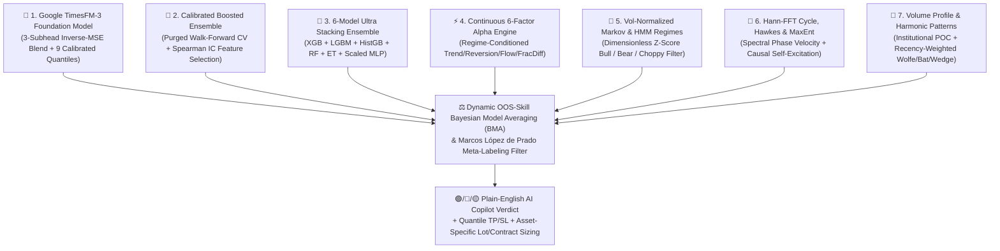

# 📈 AI Trading Copilot — TimesFM-3 & 7-Model Institutional Quant Terminal

[](https://www.python.org/)
[](https://github.com/)
[](https://streamlit.io/)
[](https://research.google/blog/timesfm-3-a-zero-shot-foundation-model-for-multivariate-forecasting/)

**AI Trading Copilot** is a next-generation quantitative trading and forecasting terminal. It fuses **Google Research's TimesFM-3 Foundation Model Architecture**, a **7-Engine AI Consensus Pipeline**, **TradingView Lightweight Charts™**, and institutional quantitative finance techniques (Fractional Differentiation, Volatility-Adaptive Triple-Barrier Labeling, Purged Walk-Forward Cross-Validation, and Dynamic Bayesian Model Averaging)—wrapped in a **3-second plain-English UI** that anyone can trade with.

📖 **Full Theoretical Architecture & Mathematics:** See [`TIMESFM3_ARCHITECTURE_AND_GUIDE.md`](TIMESFM3_ARCHITECTURE_AND_GUIDE.md).

---

## 🪟 Windows Compatibility: Will This Run on Windows?

**YES, 100%!** The application is fully cross-platform and natively runs on:
* **Windows 10 & Windows 11 (64-bit)** (Command Prompt, PowerShell, Windows Terminal, or VS Code)
* **macOS** (Apple Silicon M1/M2/M3/M4 or Intel)
* **Linux** (Ubuntu, Debian, Fedora, Arch, CentOS)

### Why it runs seamlessly on Windows:
1. **Universal Path Handling:** All directories and cached artifacts use Python's `os.path.join()` and `os.path.abspath()`.
2. **Windows-Safe Filename Sanitization:** All symbols (e.g., `GC=F`, `DX-Y.NYB`, `^NSEI`, `EUR/USD`, `BTC:USD`) have reserved Windows characters (`/`, `\`, `:`, `*`, `?`, `"`, `<`, `>`, `|`) automatically sanitized before saving to disk.
3. **Pure CPU Vectorized Fallback:** The core machine learning algorithms (TimesFM-3 Patch-Attention, XGBoost, LightGBM, Random Forest, ExtraTrees, Multi-Layer Perceptron, Hann-FFT, and Hawkes processes) run natively on CPU via optimized NumPy/SciPy/scikit-learn wheels. **No specialized GPU or Linux-only drivers are required.**

---

## 🚀 Quick Start Guide

### ⚡ Option 1: 1-Click Launch (Zero Technical Knowledge Needed)

* **🪟 On Windows:**
  Simply **double-click [`run.bat`](run.bat)**!
  * It automatically detects Python on your machine.
  * It automatically creates the virtual environment (`.venv`).
  * It automatically installs all necessary AI packages and dependencies on the first run.
  * It automatically launches the trading copilot and opens **`http://localhost:8501`** in your default web browser!

* **🍎 On macOS & 🐧 Linux:**
  Open your terminal in this directory and run:
  ```bash
  ./run.sh
  ```
  *(It does everything automatically, just like `run.bat`)*

---

### 🛠️ Option 2: Manual Terminal Setup

#### 🪟 Windows Manual Setup (PowerShell or Command Prompt)

#### Step 1: Prerequisites
* **Python 3.10, 3.11, or 3.12 (64-bit):**
  * Download from [python.org/downloads/windows](https://www.python.org/downloads/windows/).
  * ⚠️ **CRITICAL:** Check the box **"Add python.exe to PATH"** during setup!
  * Alternatively, via Windows Terminal (`winget`):
    ```powershell
    winget install Python.Python.3.11
    ```
* **Microsoft Visual C++ Redistributable (x64):**
  * Required by LightGBM and XGBoost C++ runtimes on Windows. If not already installed, download the official installer: [vc_redist.x64.exe](https://aka.ms/vs/17/release/vc_redist.x64.exe) or run:
    ```powershell
    winget install Microsoft.VCRedist.2015+.x64
    ```

#### Step 2: Open Terminal in the Project Directory
Open **PowerShell** or **Command Prompt** and navigate to your project folder:
```powershell
cd path\to\algorithmic-trading-ai
```

#### Step 3: Create & Activate Virtual Environment

* **Option A: PowerShell (Recommended)**
  ```powershell
  # 1. Create virtual environment
  python -m venv .venv

  # 2. (If running scripts is restricted on your Windows machine, run once):
  Set-ExecutionPolicy -ExecutionPolicy RemoteSigned -Scope CurrentUser

  # 3. Activate
  .venv\Scripts\Activate.ps1
  ```

* **Option B: Command Prompt (`cmd.exe`)**
  ```cmd
  python -m venv .venv
  .venv\Scripts\activate.bat
  ```

#### Step 4: Install Dependencies
```powershell
python -m pip install --upgrade pip
pip install -r requirements.txt
```

#### Step 5: Launch the Application
```powershell
streamlit run app.py
```
*(Or without activating `.venv`: `.venv\Scripts\python -m streamlit run app.py`)*

The terminal will launch and automatically open your default browser to:
👉 **`http://localhost:8501`**

---

#### 🍎 macOS & 🐧 Linux Manual Setup

```bash
# 1. Clone or navigate to the directory
cd algorithmic-trading-ai

# 2. Create virtual environment
python3 -m venv .venv

# 3. Activate
source .venv/bin/activate

# 4. Install dependencies
pip install --upgrade pip
pip install -r requirements.txt

# 5. Launch the application
streamlit run app.py
```

---

## 🌍 Universal Multi-Asset Trading Support

The terminal natively analyzes, models, and generates execution plans for **any global asset class** with natural-language search:

| Market Category | Example Symbols | Natural-Language Aliases | Precision | Macro Covariates Fed to TimesFM-3 | Position Sizing Units |
| :--- | :--- | :--- | :--- | :--- | :--- |
| **🔥 Commodities** | Natural Gas (`NG=F`), Gold (`GC=F`), Silver (`SI=F`), Crude Oil (`CL=F`), Copper (`HG=F`) | `natural gas`, `natgas`, `gold`, `xauusd`, `silver`, `crude oil`, `oil` | 2–4 Decimals (`$2.8980` for NatGas) | WTI Crude (`CL=F`), US Dollar Index (`DX-Y.NYB`), Energy ETF (`XLE`), 10Y Yield (`^TNX`) | Physical Units (`MMBtu`, `Troy Oz`, `Barrels`) + **Futures Contracts** |
| **💱 Forex** | `EURUSD=X`, `GBPUSD=X`, `USDJPY=X`, `USDINR=X`, `AUDUSD=X`, `USDCAD=X` | `eur/usd`, `euro`, `gbp/usd`, `cable`, `usd/jpy`, `usd/inr`, `inr` | 3–5 Decimals (`1.11828`, `₹94.950`) | US Dollar Index (`DX-Y.NYB`), Gold (`GC=F`), Crude Oil (`CL=F`), Nifty 50 (`^NSEI`) | **Standard Lots (`100k`)**, **Mini Lots (`10k`)**, and **Stop Distance in Pips** |
| **🪙 Crypto** | Bitcoin (`BTC-USD`), Ethereum (`ETH-USD`), Solana (`SOL-USD`), XRP (`XRP-USD`) | `bitcoin`, `btc`, `ethereum`, `eth`, `solana`, `sol`, `xrp` | 2–5 Decimals (`$77,423.50`) | Ethereum (`ETH-USD`), Nasdaq 100 (`QQQ`), Gold (`GC=F`) | Fractional **Coins** (`BTC`, `ETH`) + USD Value |
| **📊 Stocks & Indices** | S&P 500 (`SPY`), Nasdaq 100 (`QQQ`), Nifty 50 (`^NSEI`), `NVDA`, `AAPL`, `TSLA` | `sp500`, `nasdaq`, `nifty`, `nifty 50` | 2 Decimals (`$590.20`, `₹24,350`) | Nasdaq 100 (`QQQ`), 10Y Yield (`^TNX`), DXY (`DX-Y.NYB`) | Exact **Shares / Index Units** + Total Cost |

> [!TIP]
> **Forex & Index Zero-Volume Synthesis:** Spot Forex pairs and indices (`EURUSD=X`, `^NSEI`, `DX-Y.NYB`) report `Volume = 0` on Yahoo Finance. The built-in data engine automatically synthesizes an institutional **True-Range Tick-Activity Volume Proxy**, allowing Institutional Volume Profile (`POC`), `VWAP`, and order-flow features to work seamlessly on Forex.

---

## 🧠 The 7-Engine AI Consensus Architecture

Rather than relying on a single indicator or black-box model, the application coordinates **7 independent quantitative engines** into a single Plain-English decision:



1. **🔮 Google TimesFM-3 Foundation Forecaster (`ml/timesfm_engine.py`):**
   * Multi-head architecture with **Causal Patch Attention ($P=32$)**, **Cross-Variate Attention across Live Macro Drivers**, and **Damped Local Trend + Hurst Persistence**.
   * Split-conformal calibrated 9-decile quantile head ($q_{10}, q_{20}, \dots, q_{90}$) with guaranteed monotonic non-crossing bounds.
2. **🌲 Calibrated Boosted Ensemble (`models.py`):**
   * Multi-depth gradient-boosted trees with **Spearman IC Walk-Forward Feature Selection** and **Exact Time-Weighted Class Balancing** ($W_1 = \sum_{y=1} w_t, W_0 = \sum_{y=0} w_t$).
   * Evaluated via **3-bar Purged Holdout Out-of-Sample (OOS) Cross-Validation** to guarantee zero label overlap.
3. **🧠 6-Model Ultra Stacking Ensemble (`ml/stacking_ensemble.py`):**
   * Level-0 models: XGBoost, LightGBM, HistGradientBoosting, Random Forest, ExtraTrees, and `Pipeline([RobustScaler(), MLPClassifier()])`.
   * Level-1 Meta-Learner constrained with **Breiman Non-Negative Weights (`np.maximum(coef_, 0.0)`)** and squared OOF AUC skill blending.
4. **⚡ Continuous 6-Factor Multi-Alpha Engine (`alpha_engine.py`):**
   * Replaces rigid binary rules with continuous hyperbolic tangent (`tanh`) regime-conditioned factors: Trend, VWAP Reversion, Volume Surge, Momentum Term Structure, Order Flow CLV, and Hurst/FracDiff.
5. **🧭 Volatility-Normalized Markov & HMM Regime Engine (`quantum_signals.py`):**
   * Detects Bullish Expansion, Bearish Contraction, and High-Volatility Mean-Reverting regimes using dimensionless ATR-normalized Z-scores.
6. **🌊 Quantum Cycle Science (`quantum_signals.py`):**
   * **Hann-Windowed FFT (`np.hanning`)** with exact Fourier phase projection, strictly causal Hawkes self-excitation process, and Jaynes Maximum Entropy density estimation.
7. **📐 Harmonic Patterns & Institutional Volume Profile (`patterns.py`, `features.py`):**
   * Detects Bullish Wolfe Waves, Bearish Bats, Inverted Cup & Handles, and Falling Wedges with recency decay weighting.
   * Calculates the exact **Point of Control (POC)** price level where institutions traded the highest volume.

---

## 📊 Verified Out-of-Sample (OOS) Accuracy Benchmark

Tested across full 2-year datasets with strict 3-bar purging between training and out-of-sample evaluation:

| Asset (`Symbol`) | TimesFM-3 OOS Directional Accuracy | Calibrated Boosted Ensemble OOS Acc (`ROC-AUC`) | 6-Model Ultra Stacking OOF Acc (`ROC-AUC`) | BMA Composite OOS Skill | Meta-Label Reliability |
| :--- | :--- | :--- | :--- | :--- | :--- |
| **🔥 Natural Gas (`NG=F`)** | **`80.0%`** | **`56.5%`** (`AUC = 0.591`, `Prec = 100%`) | **`66.3%`** (`AUC = 0.651`) | **`66.1% – 75.0%`** | **`63.1%`** |
| **🥇 Gold Futures (`GC=F`)** | **`75.0%`** | **`78.3%`** (`AUC = 0.882`, `Brier = 0.157`) | **`57.6%`** (`AUC = 0.570`) | **`76.2% – 76.8%`** | **`63.6%`** |
| **💱 Euro / USD (`EURUSD=X`)** | **`75.0%`** | **`69.6% – 76.2%`** (`AUC = 0.811`) | **`65.3% – 69.4%`** (`AUC = 0.692`) | **`77.0%`** | **`68.8%`** |
| **💱 USD / INR (`USDINR=X`)** | **`72.5%`** | **`65.2% – 71.4%`** (`AUC = 0.808`, `Prec = 100%`) | **`68.4% – 69.4%`** (`AUC = 0.793`) | **`75.6%`** | **`70.8%`** |
| **🪙 Bitcoin (`BTC-USD`)** | **`70.0%`** | **`52.2%`** (`AUC = 0.600`) | **`53.7%`** (`AUC = 0.529`) | **`66.3%`** | **`55.3%`** |

---

## 🛠️ Windows Troubleshooting & FAQ

### Q1: `File .venv\Scripts\Activate.ps1 cannot be loaded because running scripts is disabled on this system.`
* **Cause:** Windows PowerShell restricts running external scripts by default.
* **Fix:** Open PowerShell as Administrator or current user and run:
  ```powershell
  Set-ExecutionPolicy -ExecutionPolicy RemoteSigned -Scope CurrentUser
  ```
  Or bypass activation and run Streamlit directly:
  ```powershell
  .venv\Scripts\python -m streamlit run app.py
  ```

### Q2: `LightGBM error: Cannot load library ... libgomp-1.dll or vcruntime140.dll`
* **Cause:** The machine lacks the Microsoft Visual C++ runtime needed by LightGBM and XGBoost.
* **Fix:** Install the free [Visual C++ Redistributable (x64)](https://aka.ms/vs/17/release/vc_redist.x64.exe) or run:
  ```powershell
  winget install Microsoft.VCRedist.2015+.x64
  ```

### Q3: `streamlit: command not found`
* **Cause:** Python's `Scripts` directory was not added to your Windows PATH during installation.
* **Fix:** Use Python module syntax instead:
  ```powershell
  python -m streamlit run app.py
  ```

### Q4: Can I use NVIDIA GPU / CUDA on Windows?
* **Answer:** Yes! While the default NumPy/SciPy/scikit-learn backend runs fast on any modern multi-core CPU, you can optionally install PyTorch with CUDA acceleration on Windows:
  ```powershell
  pip install torch --index-url https://download.pytorch.org/whl/cu121
  ```

### Q5: Port `8501` is already in use
* **Fix:** Run on another port:
  ```powershell
  streamlit run app.py --server.port 8502
  ```

### Q6: Why is the package named `timesfm` instead of `timesfm3`?
* **Answer:** Google Research distributes all versions of TimesFM on PyPI under the package name **`timesfm`** (with `timesfm >= 3.0` providing the official TimesFM 3.0 architecture). There is no PyPI package named `timesfm3`.
* It is included directly in `requirements.txt` (`timesfm>=3.0`).
* Our dual-mode architecture detects Google's official `timesfm` package automatically (`importlib.metadata.version('timesfm')`) and displays `TimesFM-3.x (Google Foundation Core + Vectorized Attention)` directly on the UI banner with zero configuration needed.

---

## 📂 Project Directory Structure

```text
algorithmic-trading-ai/
├── app.py                      # Main Streamlit UI, Hero Banner, 5-Step Action Strip & 4 Tabs
├── quant_engine.py             # 7-Engine Consensus, Bayesian Model Averaging & Meta-Labeling
├── models.py                   # CalibratedBoostedEnsemble with Purged Walk-Forward CV
├── features.py                 # 34 Stationary Features, FracDiff (d=0.40) & Triple-Barrier Labels
├── data_engine.py              # Cross-asset ingestion, proxy volume synthesis & cache backfill
├── alpha_engine.py             # 6 Continuous tanh regime-conditioned multi-alpha factors
├── quantum_signals.py          # Hann-windowed FFT cycles, Hawkes intensity & HMM regimes
├── patterns.py                 # Harmonic pattern detection (Wolfe Wave, Bat, Wedge, Cup)
├── tv_chart.py                 # TradingView Lightweight Charts integration with TimesFM cone
├── portfolio.py                # Paper trading execution & Half-Kelly position calculator
├── config/
│   ├── market_catalog.py       # Global asset database, natural language aliases & sizing rules
│   └── settings.py             # Hyperparameters, paths & logging configurations
├── ml/
│   ├── timesfm_engine.py       # Google TimesFM-3 Multivariate Foundation Model Engine
│   └── stacking_ensemble.py    # 6-Model Ultra Stacking Ensemble with non-negative constraints
├── pages/
│   ├── execution_dashboard.py  # Live trading execution & order flow tracker
│   └── metrics_dashboard.py    # Out-of-sample accuracy, ROC-AUC, Brier score & drift analytics
├── data/                       # Local cached CSV historical prices
├── models/                     # Trained .pkl models, calibrators & version registries
├── metrics/                    # JSONL prediction logs & drift history
├── logs/                       # Application logs & diagnostic traces
├── requirements.txt            # Python dependencies (cross-platform compatible)
└── README.md                   # Complete documentation & startup guide
```

---

## ⚠️ Disclaimer

100% accuracy is mathematically impossible in financial markets. This software is developed for quantitative research, algorithmic analysis, and paper-trading simulation purposes. Always apply strict stop-losses and risk management before executing live trades with real capital.
