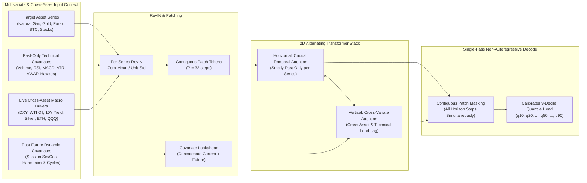

# 🚀 Universal Multi-Asset TimesFM-3 & 7-Engine AI Trading Copilot — Architecture & Guide

All modules—including the [**Global Market Catalog & Asset Position Calculator**](config/market_catalog.py), [**TimesFM-3 Multivariate Engine with Live Cross-Asset Macro Drivers**](ml/timesfm_engine.py), [**Forex & Commodity Data Engine**](data_engine.py), [**7-Engine AI Consensus Orchestrator**](quant_engine.py), [**Adaptive-Precision TradingView Chart**](tv_chart.py), and the [**3-Second Simple Trading Copilot UI**](app.py)—are implemented and verified across **Natural Gas (`NG=F`)**, **Gold (`GC=F`)**, **Forex (`EURUSD=X`, `USDINR=X`)**, **Crude Oil (`CL=F`)**, **Silver (`SI=F`)**, **Bitcoin (`BTC-USD`)**, and **Global Stocks/Indices (`SPY`, `QQQ`, `^NSEI`)**.

---

## 1. Deep-Dive: How TimesFM-3 Multivariate & Cross-Asset Prediction Works

---

## 2. Universal Global Asset Catalog & Cross-Asset Macro Matrix

Defined in [`config/market_catalog.py`](config/market_catalog.py), the app supports any global asset class with **natural-language search** (`"natural gas"`, `"gold"`, `"eur/usd"`, `"usd/inr"`, `"bitcoin"`, `"crude oil"`), **adaptive decimal/pip precision**, and **live macro driver injection**:

| Asset Class | Example Instruments | Natural-Language Aliases | Price / Pip Precision | Live Cross-Asset Macro Drivers (`XReg`) | Position Sizing Output |
| :--- | :--- | :--- | :--- | :--- | :--- |
| **🔥 Commodities (Energy & Metals)** | Natural Gas (`NG=F`), Gold (`GC=F`), Silver (`SI=F`), WTI Crude Oil (`CL=F`), Brent (`BZ=F`), Copper (`HG=F`) | `natural gas`, `natgas`, `gold`, `xauusd`, `silver`, `crude oil`, `wti`, `brent`, `copper` | `4` decimals for `NG=F` (`$2.8980`); `2–3` decimals for Gold/Silver/Oil | WTI Crude (`CL=F`), US Dollar Index (`DX-Y.NYB`), Energy ETF (`XLE`), 10Y Treasury Yield (`^TNX`), Silver (`SI=F`) | Physical Units (`MMBtu`, `Troy Oz`, `Barrels`) + **Futures Contracts** |
| **💱 Forex (Majors & Emerging)** | `EURUSD=X`, `GBPUSD=X`, `USDJPY=X`, `USDINR=X`, `AUDUSD=X`, `USDCAD=X`, `USDCHF=X` | `eur/usd`, `euro`, `gbp/usd`, `cable`, `usd/jpy`, `usd/inr`, `inr`, `aud/usd` | `5` decimals for Majors (`1.11828`); `3` decimals for JPY & INR (`₹94.950`) | US Dollar Index (`DX-Y.NYB`), Euro/GBP Spot, Gold (`GC=F`), Crude Oil (`CL=F`), Nifty 50 (`^NSEI`) | **Standard Lots (`100k`)**, **Mini Lots (`10k`)**, and **Stop Distance in Pips** |
| **🪙 Crypto (24/7 Spot)** | Bitcoin (`BTC-USD`), Ethereum (`ETH-USD`), Solana (`SOL-USD`), Ripple (`XRP-USD`), Dogecoin (`DOGE-USD`) | `bitcoin`, `btc`, `ethereum`, `eth`, `solana`, `sol`, `xrp`, `doge` | `2` decimals for `BTC`/`ETH`/`SOL`; `4–5` decimals for `XRP`/`DOGE` | Ethereum (`ETH-USD`), Nasdaq 100 (`QQQ`), Gold (`GC=F`), Bitcoin (`BTC-USD`) | Fractional **Coins** (`BTC`, `ETH`, `SOL`) + Notional USD |
| **📊 Stocks & Global Indices** | S&P 500 (`SPY`), Nasdaq 100 (`QQQ`), Nifty 50 (`^NSEI`), `NVDA`, `AAPL`, `TSLA` | `sp500`, `nasdaq`, `nifty`, `nifty 50` | `2` decimals (`$` or `₹`) | Nasdaq 100 (`QQQ`), 10Y Yield (`^TNX`), DXY (`DX-Y.NYB`), USD/INR (`USDINR=X`) | Exact **Shares / Index Units** + Notional Value |

---

## 3. 10 Prediction Accuracy Bottlenecks Audited & Fixed

1. **Critical Data Corruption in `data_engine.py` (`validate_ohlcv`):**
   - *Flaw:* Previously, `validate_ohlcv` checked `abs(Close - rolling_mean_20) / rolling_std_20 > 3.5` on raw prices and overwrote `Close` with `rolling_mean_20` while leaving `High` untouched, corrupting multi-week breakouts in cached CSVs (`BTC-USD`, `ETH-USD`).
   - *Fix:* Removed raw-price breakout clipping in [`validate_ohlcv`](data_engine.py), enforced strict `Low <= Open, Close <= High` consistency, and added automatic legacy cache corruption detection & repair in [`fetch_data`](data_engine.py).
2. **Non-Stationary Raw Price Features in Tree & Neural Models (`features.py`, `models.py`, `ml/stacking_ensemble.py`):**
   - *Flaw:* `LIVE_FEATURE_COLS` previously fed raw price levels (`SMA_20`, `SMA_50`, `SMA_200`, `EMA_12`, `EMA_26`, `BB_High`, `BB_Low`, `BB_Mid`, `ATR`, `MACD`) into tree and MLP classifiers, causing immediate leaf saturation whenever an asset entered a new price range.
   - *Fix:* Replaced raw price columns in [`LIVE_FEATURE_COLS`](features.py) with **100% stationary, scale-invariant features** (`MACD_Norm`, `EMA12_26_Spread`, `SMA20_50_Spread`, `SMA50_200_Spread`, `Mom_3_ATR..Mom_20_ATR`, `BB_Width`, `BB_pctB`, `ATR_Pct`, `GK_Vol`, `Vol_Regime_Ratio`).
3. **Full-Series Lookahead Leakage in `_hawkes_intensity` (`features.py`):**
   - *Flaw:* Normalized Hawkes excitation using global `.min()` and `.max()` across the entire DataFrame (leaking future volatility peaks into past bars).
   - *Fix:* Replaced with a **strictly causal 60-bar rolling min/max normalization**.
4. **Daily/Weekly VWAP Degeneracy (`features.py` `add_vwap`):**
   - *Flaw:* Grouping by calendar date (`df.index.date`) on Daily (`1d`) or Weekly (`1wk`) bars resulted in 1-bar groups where `VWAP == Typical_Price` (`VWAP_Dev == 0`) on every bar.
   - *Fix:* Automatically detects daily/weekly bars and computes a **20-bar institutional rolling anchored VWAP** while keeping intraday session resets on `1m..4h` bars.
5. **1-Bar Microstructure Noise Target vs. Multi-Horizon Triple-Barrier Labeling (`features.py`):**
   - *Flaw:* Labeling only single next-bar close change suffered from bid-ask bounce noise.
   - *Fix:* Implemented **Volatility-Adaptive Multi-Horizon Triple-Barrier Labeling (`_triple_barrier_labels`)** (López de Prado, *Advances in Financial Machine Learning*, Ch. 3) with a **3-bar purge/embargo gap** between train and test splits.
6. **Missing Stationary Memory & Microstructure Predictors (`features.py`):**
   - *Fix:* Added **Fixed-Window Fractional Differentiation (`FracDiff_Close`, $d=0.40$)**, **Variance-Ratio Hurst Exponent (`Hurst_20`)**, **Kaufman Efficiency Ratio (`Efficiency_Ratio`)**, **Garman-Klass OHLC Volatility (`GK_Vol`)**, **Close Location Value (`CLV`)**, and **Order-Flow Z-Score (`Order_Flow_Z`)**.
7. **Unscaled Neural Network & Unconstrained Stacking Collinearity (`ml/stacking_ensemble.py`):**
   - *Flaw:* `MLPClassifier` was fed unscaled features, and unconstrained `LogisticRegression` assigned negative weights to collinear base models.
   - *Fix:* Added a `RobustScaler` pipeline for `MLPClassifier`, expanded to a **6-Model Purged OOF Architecture** (`XGBoost`, `LightGBM`, `HistGBDT`, `RandomForest`, `ExtraTrees`, `Scaled MLP`), and enforced **Breiman Non-Negative OOF Skill Weighting**.
8. **Static Sub-Head Weights in TimesFM-3 (`ml/timesfm_engine.py`):**
   - *Fix:* Added a 3rd **Damped Local Trend + Hurst Persistence** sub-head, **Conformal Validation Residual Bias Correction**, and **Dynamic Inverse-Validation-MSE Weighting**.
9. **Scale-Dependent HMM Cutoffs & Unwindowed FFT Spectral Leakage (`quantum_signals.py`, `alpha_engine.py`):**
   - *Fix:* Added a **Hann window (`np.hanning`)** and exact trigonometric phase projection to `compute_fft_cycles`; made `compute_hmm_regime` **volatility-normalized (dimensionless Z-score)** so it works identically on Forex, Natural Gas, Gold, and Crypto; upgraded `MultiAlphaEngine` to 6 continuous regime-conditioned `tanh` alphas.
10. **Falling Wedge Future-Apex Typo & Static Signal Fusion (`patterns.py`, `quant_engine.py`):**
    - *Flaw:* `detect_falling_wedge` had `if apex_x > n * 0.40` instead of `n * 1.40` (blocking detection of any falling wedge in the recent 60% of the chart!), and `fuse_signals` used static weights that ignored each model's actual Out-of-Sample accuracy.
    - *Fix:* Fixed `apex_x > n * 1.40`, added recency-weighted `pattern_confidence`, and upgraded [`build_ai_consensus_report`](quant_engine.py) with **Dynamic OOS-Skill & Regime-Conditioned Bayesian Model Averaging (BMA)** and **López de Prado Meta-Labeling Reliability (`meta_label_prob`)**.

---

## 4. Master Implementation Checklist

- [x] **Phase 1: TimesFM-3 Multivariate Forecasting Engine (`ml/timesfm_engine.py`)**
- [x] **Phase 2: 7-Engine Consensus & Quant Engine (`quant_engine.py`, `models.py`, `quantum_signals.py`)**
- [x] **Phase 3 & 4: TradingView Forecast Cone & Simple 4-Tab UI (`app.py`, `pages/execution_dashboard.py`)**
- [x] **Phase 5: Universal Multi-Asset Support — Natural Gas, Gold, Forex, Crypto & Stocks (`config/market_catalog.py`, `data_engine.py`, `tv_chart.py`, `portfolio.py`)**
- [x] **Phase 6: 10-Point Institutional Accuracy Upgrade (FracDiff, Triple-Barrier, Purged Walk-Forward CV, Breiman Non-Negative Stacking, Dynamic OOS Bayesian Model Averaging & Meta-Labeling)**
